# AI Music Studio

[](https://github.com/pierrecinema/ai-music-studio/releases) [](https://github.com/pierrecinema/ai-music-studio/releases/latest) [](LICENSE)

[](https://youtu.be/FTNmsRxWuy4)

**🎬 [Watch the 0.60 tour on YouTube (2 minutes)](https://youtu.be/FTNmsRxWuy4)**

**Free, open-source AI music studio for Windows:** make songs, seamless loops and stems with AI on your own PC, and arrange them in a full studio (DAW) with mixer, piano roll and automation. No account, no subscription. The AI assistant works with Claude, ChatGPT, Grok or completely free and local with Ollama.

## Easy Windows installation

No programming, no command line: just the installer.

1. **Download** `AIMusicStudio-Setup-<version>.exe` from the **[latest release](https://github.com/pierrecinema/ai-music-studio/releases/latest)**.
2. **Run it.** The first time, Windows shows a blue window *"Windows protected your PC"* (Microsoft Defender SmartScreen), because the installer is not code-signed yet and Windows does not know the publisher. It is not a virus warning: click **More info**, then **Run anyway**. Some antivirus programs ask as well.
3. **Start AI Music Studio.** The Studio, piano roll, mixer and library work right away.
4. **For the AI features** (songs, loops, stems, mastering): install [Python](https://www.python.org/downloads/) 3.11 or 3.12 once (tick *"Add python.exe to PATH"*), then in the app open **Settings → AI Engines** and click **Install selected**. The app sets everything up by itself and downloads the models (several GB, once).

**Updates come automatically:** the app checks for new versions and installs them with one click (Settings → Updates). The SmartScreen warning only comes with the installer downloaded in the browser.

**[📖 Wiki: every menu and function explained](https://github.com/pierrecinema/ai-music-studio/wiki)** · Manual (German, incl. first-time setup): [docs/MANUAL.md](docs/MANUAL.md) · Testing and reporting problems: [docs/TESTING.md](docs/TESTING.md) · Test plan: [docs/TESTPLAN.md](docs/TESTPLAN.md)

### ☕ Buy me a coffee

AI Music Studio is free and stays free, made in my spare time. If it saves you time or makes you a track you love, you can buy me a coffee. It keeps the project going: new features, more AI models and code signing for the installer. A ⭐ on GitHub helps too!

[](https://paypal.me/djpedroflores)

## What's new

### New in 0.90: MIDI effects; 0.86: Russian; 0.85: a console-style Mixer; 0.84: real instruments for MIDI tracks

- **MIDI effects** (arpeggiators, sequencers, chord generators) in front of a VST instrument: Channel → MIDI effects. Plugins now follow the song's tempo and position.

- **Русский**: the whole app in Russian (Settings → General → Language).
- Long track names are readable in the Studio; clips no longer show through the track header.

- **Mixer** like a studio console: white-cap faders with a dB scale, orange LED meters, lit mute / solo keys, pan knobs (0.85.1: narrower strips, pan by dragging sideways).

- **Sound pack** (one download, about 28 MB): recorded piano, guitars, basses, seven drum kits, strings, brass, saxophones and more play your MIDI tracks instead of the simple synthesizer. About 50 instruments to pick per track.
- **The song generator picks a band per genre** (funk: clavinet, slap bass, brass; jazz: sax, upright bass, jazz kit; ballad: piano, strings, brushes …) and a first mix with levels and room reverb.
- A new generated song starts at bar 1.
- Full history: [CHANGELOG.md](CHANGELOG.md).

## Features

### Studio (DAW): available now

A full arrangement studio in the app, with the shortcuts of **Ableton Live 12** or **Cubase** (Settings → Shortcuts).

- **Arrangement:** audio and MIDI tracks, drag and drop from the Library or Explorer, multi-select, copy / cut / paste, duplicate (Ctrl+D lines up loops without a gap), split, consolidate, crossfades
- **Timing:** loop range in the ruler, markers and cycle markers, tempo and time-signature track, snap to grid, warp markers, AUTO SYNC of imported audio to the project tempo
- **Recording:** count-in, punch in / out, loop recording into take lanes with comping
- **VST plugins:** your VST3 and VST2 effects (64-bit and 32-bit) on every track, with their own windows; Settings → Plugins finds them
- **Mixing:** mixer with faders, pan, mute, solo and live level meters, volume and pan automation lanes, reverb and delay return tracks with sends, group tracks, a channel tab per track
- **Piano Roll:** draw, move and quantize MIDI notes
- **Right in the Studio:** split a clip into stems from the right-click menu, quick export of the song
- **Projects:** save and open, undo / redo

### AI: available now

| Feature | What it does | Technology |
|---|---|---|
| **Create music** | Songs from a style description and lyrics; vocals with ACE-Step, instrumentals with MusicGen; a cappella mode; every track starts on beat 1 | ACE-Step 1.5 / v1, MusicGen, DiffRhythm |
| **Create loop** | Exactly 1–16 bars, starts on beat 1, repeats seamlessly, named with tempo and bars | own loop cutter on the beat grid |
| **Stem Splitter** | Vocals, drums, bass, piano, guitar and more; a stem mixer (solo, mute, volume) with remix export, e.g. karaoke without vocals; saved to the Library and exported for any DAW | Meta Demucs (htdemucs_ft) |
| **Audio → MIDI** | The melody of a stem as notes on a MIDI track, opened in the Piano Roll | Spotify basic-pitch |
| **Mastering** | Full mastering workspace: an AI assistant that measures the song and suggests settings per genre; EQ, dynamic EQ, compressor, multiband, saturation / exciter, stereo, true-peak limiter to a loudness target, master gain fader; cut, fade and normalise; LUFS / true peak / spectrum / goniometer before and after; export in 8 formats with metadata; reference match | own DSP (Web Audio worklets), Matchering, ffmpeg |
| **Library** | Songs, loops, stems and samples with tempo and tags; search by name, tag or BPM; export as WAV, AIFF, FLAC or MP3 | |
| **AI Chat** | Music assistant for chords, lyrics and ideas | Claude, ChatGPT, Grok, or free and local with Ollama |
| **Hardware** | Runs on the CPU; faster on NVIDIA (CUDA) and AMD / Intel graphics cards (DirectML) | PyTorch |
| **Languages** | The whole app in English, German, French, Spanish, Italian, Portuguese, Russian and Chinese; menus in Japanese and Korean | |

### Coming soon

| Feature | What it will do |
|---|---|
| **Instrument plugins, plugins on the master and in Mastering** | VST effects work in the Studio tracks since 0.50; instruments and the master follow |
| **Vocal Editor** | AI singing from notes and lyrics, voice cloning |
| **AI Instruments** | AI-played instruments for your MIDI tracks |
| **Karaoke Export** | Word timing, .lrc files and lyric videos |
| **Video Composer** | Music that follows the cuts of your video |
| **Cloud Rendering (Pro)** | Optional: render on fast NVIDIA cards in the cloud. Everything above stays free and local. |

## Screenshots

*Shown with demo content: example songs, a demo project and a PC without AI engines installed yet. All pages below the first picture are shown in the Hardware rack look.*

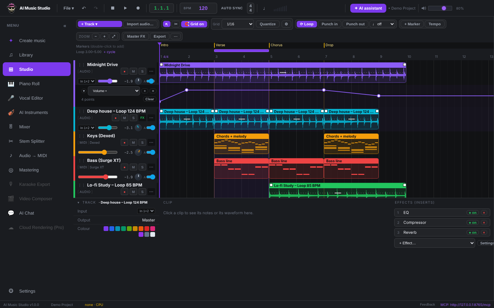
**Studio** – arrangement with loop and markers, volume automation, tempo-synced loops pasted one after the other, MIDI tracks with the free instruments Dexed and Surge XT and a reverb return track.


**The same Studio in the Hardware rack look** – the selected track's effects (EQ, compressor, reverb) as rack modules with knobs at the right.


**Create music** – describe the style, write lyrics, pick a model and make a song or a seamless loop (1–16 bars). Simple and Studio mode.


**Library** – every created song and loop is kept with its tempo; loops are named like "Deep house – Loop 124 BPM 4 bars".


**Mastering** – waveform before and after with a marked region to cut, fade or change the volume; meters before and after (loudness, true peak, spectrum, goniometer), same-loudness A/B and export in every format.


**Mastering assistant** – measures tone balance per octave, dynamics, stereo and loudness against the genre and suggests settings, each with its reason; apply all with one click and compare.

### Looks

*Settings → Appearance* has four looks. Here is the same Studio project in each of them:

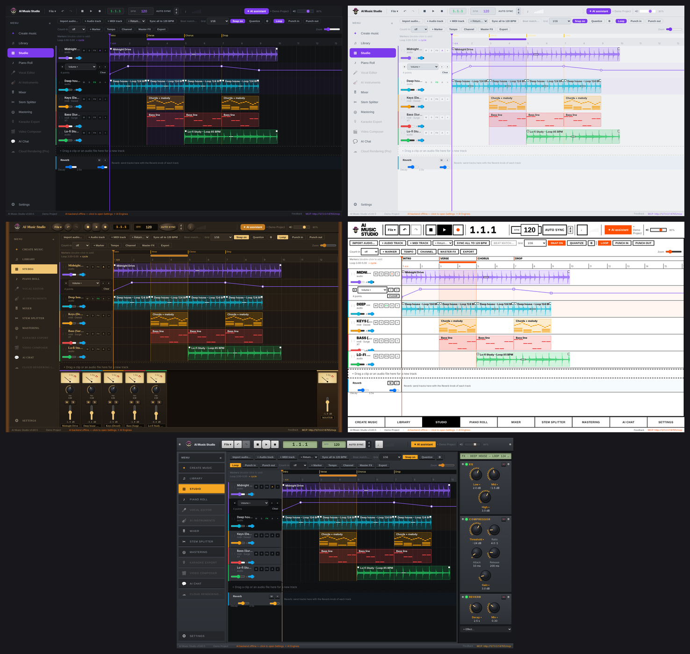


**Dark** – the standard look.


**Light** – the same layout on a light background.


**Swiss** – white and black, big heavy numbers for position and tempo, the transport as big black blocks, large capital track names, no rounded corners, orange as the only colour, the menu as a bar along the bottom.


**Hardware rack** – grey device fronts with screws, a wide green LCD for position and tempo, the menu at the side as rack keys, the selected track's effects as rack modules with knobs at the right.

| | |
|---|---|
| 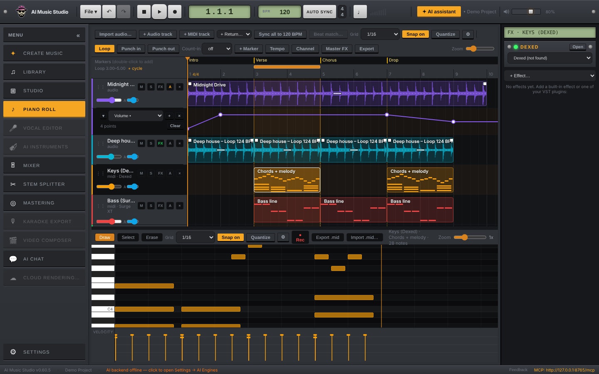<br>**Piano Roll** – draw, move and quantize MIDI notes | 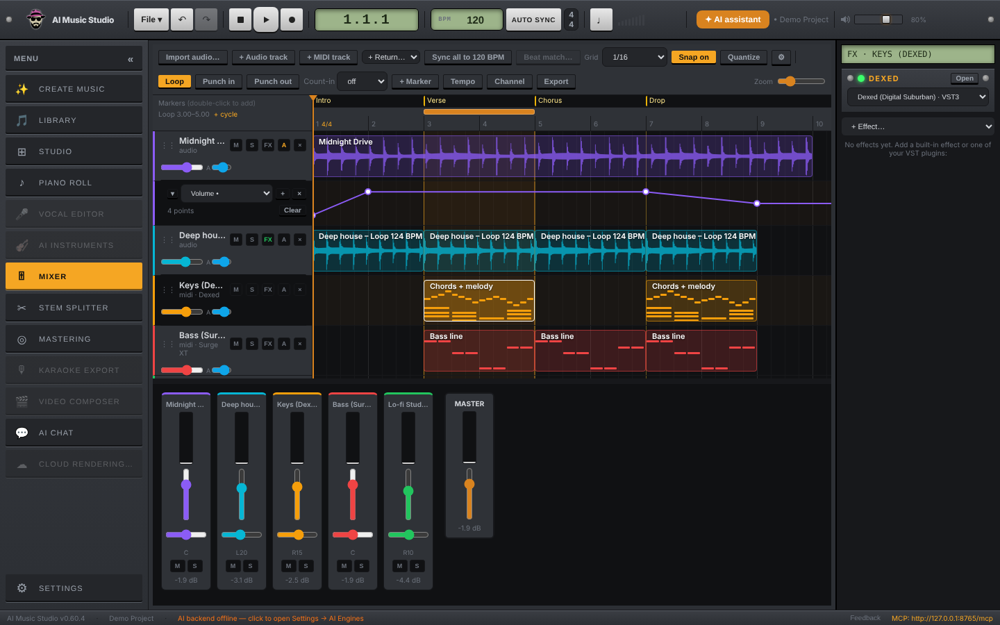<br>**Mixer** – faders, pan, mute/solo, level meters, master |
| 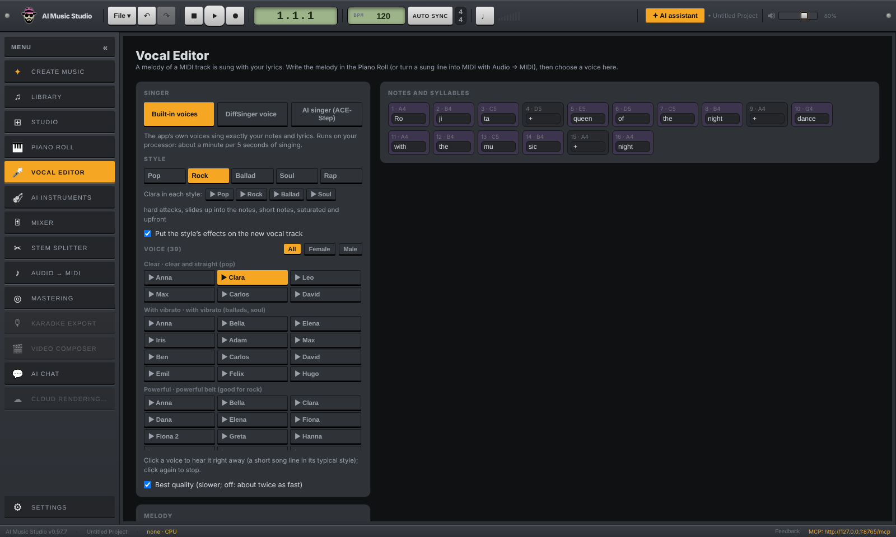<br>**Vocal Editor** – voices and lyrics for AI singing (coming soon) | <br>**AI Instruments** – instruments for MIDI tracks (coming soon) |
| <br>**Stem Splitter** – vocals, drums, bass and more with Demucs | 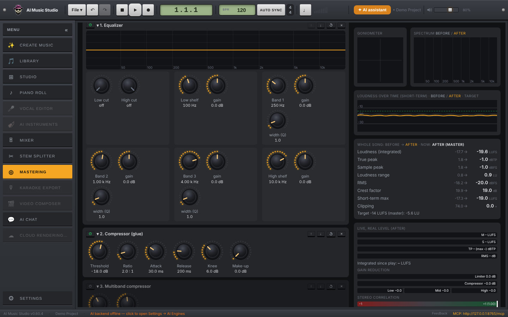<br>**Mastering chain** – EQ, compressor, multiband, stereo, limiter with loudness target, master gain fader |
| 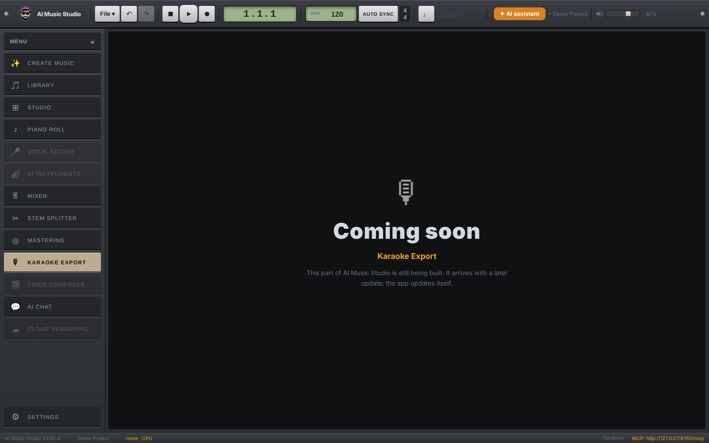<br>**Karaoke Export** – word timing, .lrc and lyric videos (coming soon) | 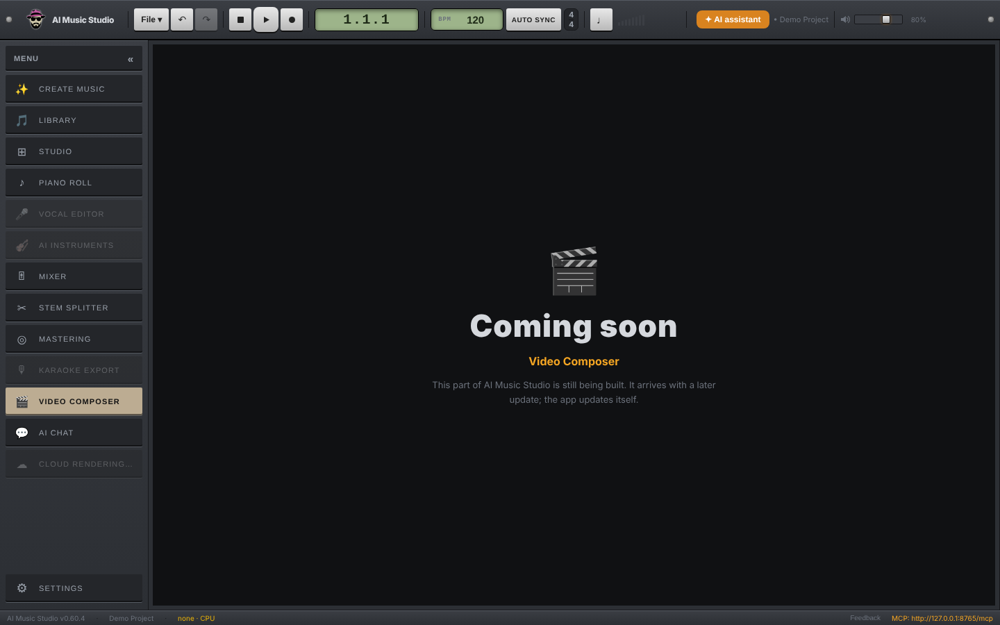<br>**Video Composer** – music that follows the cuts of a video (coming soon) |
| <br>**AI Chat** – Claude, ChatGPT, Gemini, Grok or a local model as a music assistant that can also make songs | 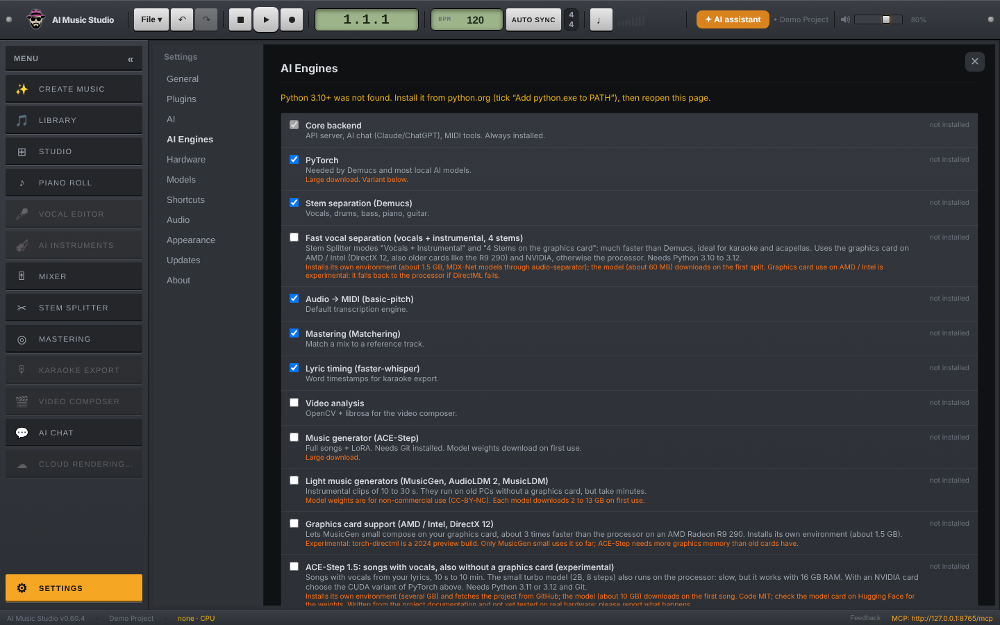<br>**Settings → AI Engines** – install the local AI models with one click |
| 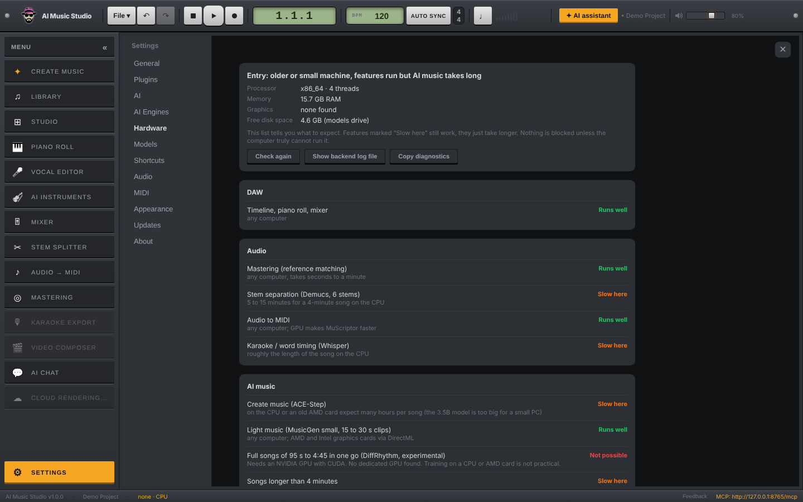<br>**Settings → Hardware** – what this PC can run, and how fast | 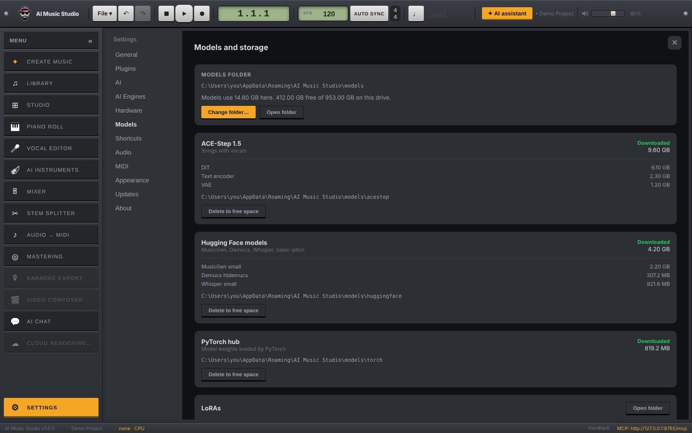<br>**Settings → Models** – downloaded models, sizes and the models folder |
| <br>**Settings → Shortcuts** – Ableton Live 12 or Cubase key layout | 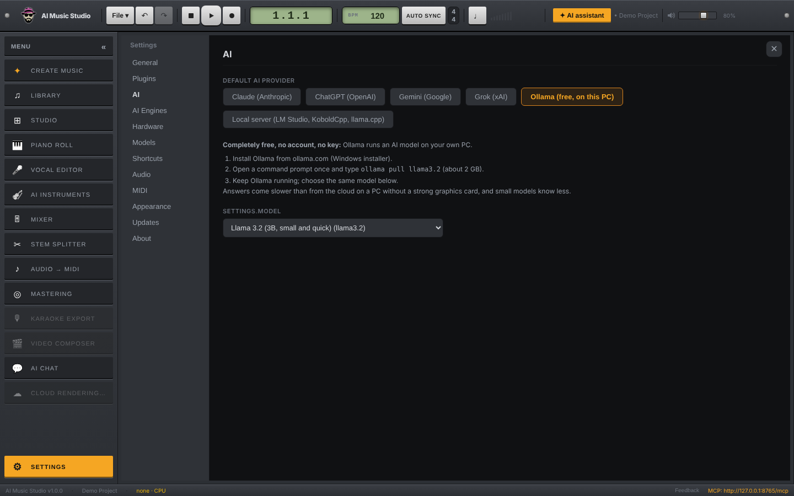<br>**Settings → AI** – Claude, ChatGPT, Gemini, Grok, Ollama or a local server for the AI chat |
| 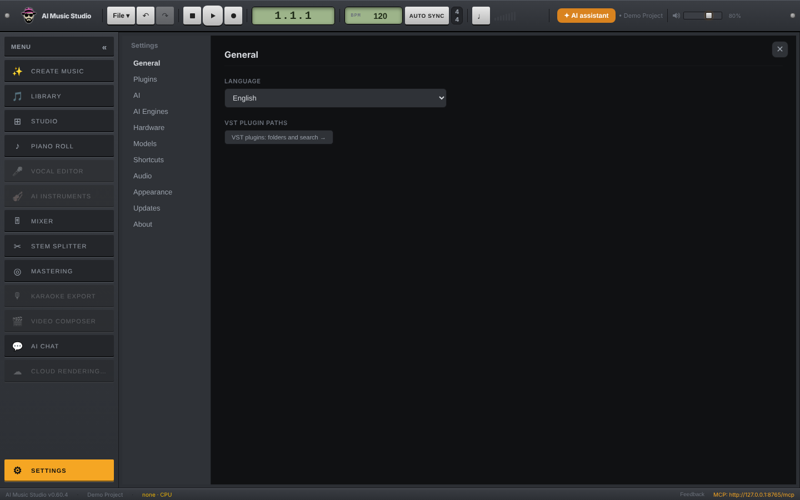<br>**Settings → General** – language (VST plugins: Settings → Plugins) | <br>**Settings → Audio** – export sample rate (44.1 kHz for platforms) and buffer size |
| 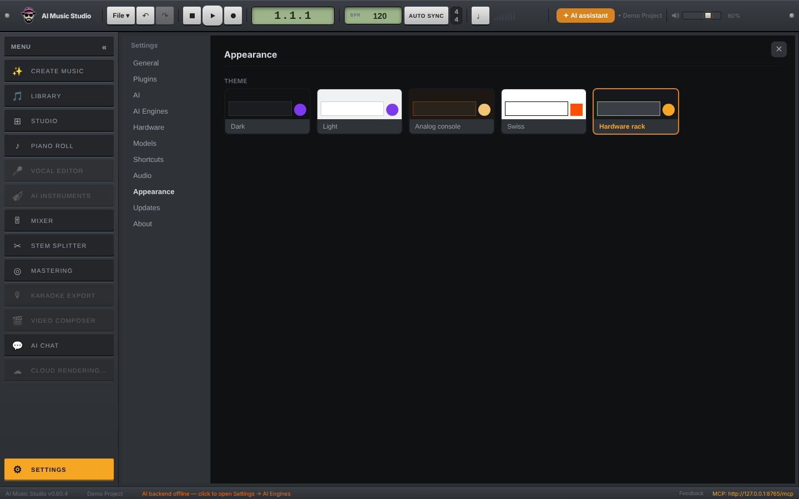<br>**Settings → Appearance** – Dark, Light, Swiss or Hardware rack | <br>**Settings → Updates** – automatic updates from GitHub releases |

**Found a problem?** ([guide, German](docs/TESTING.md)) Reports are very welcome, especially from PCs with **NVIDIA cards**: open *Feedback → Record a detailed log*, reproduce the problem, then attach the saved log to a GitHub issue. Nothing is sent automatically.

## Low-resource mode (8 GB VRAM / 12 GB RAM)

The backend measures VRAM/RAM at startup (`GET /health` → `hardware.resources`) and switches to
low-memory mode on small machines: CPU offload for idle model parts, fp16, shorter max song length,
small Demucs segments, and a smaller Whisper model. Only one heavy generation runs at a time.
Override detection with `AMS_VRAM_GB=8`.

Extra engines are optional and installed separately:

```bash
pip install git+https://github.com/ace-step/ACE-Step.git   # full-song generation + LoRA
pip install matchering faster-whisper                        # mastering, lyric timing
# ffmpeg on PATH for karaoke video export
```

LoRAs: drop `.safetensors` files/folders into `~/.ai-music-studio/loras` or import them in the Music Generator panel.

## Architecture

```
ai-music-studio/
├── apps/
│   ├── desktop/      # Electron app (TypeScript + React)
│   └── server/       # FastAPI backend (Python)
├── packages/
│   ├── plugin-host/  # JUCE C++ host for VST3 / VST2 plugins
│   └── vst-bridge/   # VST3 Bridge Plugin (JUCE C++)
```

## Optional: build from source (developers only)

*Not needed to use the app: the [Windows installer](#easy-windows-installation) is all you need.* This is for people who want to change the code.

### Prerequisites

- Node.js 20+ and pnpm
- Python 3.11+
- CMake 3.22+ (for the JUCE plugin host / VST bridge)
- JUCE 7.x (auto-downloaded via CMake)

### Install & Run

```bash
# 1. Install Node dependencies
pnpm install

# 2. Set up Python environment
cd apps/server
python -m venv .venv
.venv\Scripts\activate      # Windows
pip install -r requirements.txt

# 3. Start the Python backend
python main.py

# 4. In another terminal — start the Electron app
cd ../..
pnpm dev
```

### Build the VST3 Bridge Plugin

```bash
cd packages/vst-bridge
cmake -B build -DCMAKE_BUILD_TYPE=Release
cmake --build build --config Release
# Plugin installs to C:\Program Files\Common Files\VST3\AMS Bridge.vst3
```

## AI Configuration

Open **Settings → AI** in the app:

1. Choose **Claude (Anthropic)** or **ChatGPT (OpenAI)**
2. Paste your API key
3. Select the model

The AI assistant helps with chord progressions, lyrics, music theory, and generation tasks.

## Optional: installing AI models by hand (developers only)

Users install everything with **Settings → AI Engines → Install selected** in the app. The commands below are only for a development setup:

```bash
# Stem separation (Meta Demucs) — requires ~2 GB
pip install demucs

# Audio → MIDI (Spotify basic-pitch)
pip install basic-pitch

# GPU acceleration
pip install torch torchaudio --index-url https://download.pytorch.org/whl/cu121
```

## Languages

Switch language in **Settings → General → Language**:
- Fully translated: English, Deutsch, Français, Español, Italiano, Português, Русский, 中文
- Menus only so far: 日本語, 한국어
- How to add or improve a translation: [docs/TRANSLATING.md](docs/TRANSLATING.md)

## Code signing policy

The Windows installer is **not code-signed yet**, so Windows SmartScreen warns on the first install (see *Easy Windows installation*). We applied to the [SignPath Foundation](https://signpath.org) for free code signing for open-source projects; they asked us to come back once the project is better known, and we will reapply. You can help: a ⭐ on GitHub, a post or a video about the app all count. When signing is in place, these rules apply:

- Only installers built by the GitHub Actions workflow `.github/workflows/release.yml` from this repository are signed; nothing built elsewhere.
- Committers and reviewers: [pierrecinema](https://github.com/pierrecinema) (owner; changes are made with the help of AI coding tools and merged by the owner's instruction)
- Approvers (sign each release): [pierrecinema](https://github.com/pierrecinema)

### Privacy

This program does not send any data on its own except where the user turns a feature on:
- **Update check:** asks GitHub for the latest release (no personal data).
- **AI engines and models:** downloads packages from PyPI and model files from Hugging Face when you install them in *Settings → AI Engines / Models*.
- **AI chat:** sends your chat messages to Anthropic (Claude), OpenAI (ChatGPT) or xAI (Grok) only if you enter your own API key in *Settings → AI*. With Ollama the chat stays on your PC.
- **Feedback / logs:** reports and detailed logs are only copied or saved on your PC; nothing is uploaded automatically.

Music generation itself runs locally on your computer.

## License

GPL-3.0 — see [LICENSE](LICENSE)

## Contributing

PRs welcome. See [CONTRIBUTING.md](docs/CONTRIBUTING.md) for details.
