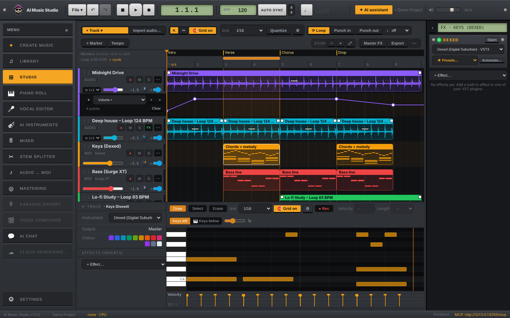

# AI Music Studio Wiki

**Free, open-source AI music studio and DAW for Windows.** Make songs, seamless loops and stems with AI on your own PC, split songs into stems, turn audio into MIDI, sing your melodies with AI voices, play AI instruments, mix and master, and arrange it all in a full studio with piano roll, mixer, automation and VST plugins. No account, no subscription.

🎬 [Tour on YouTube](https://youtu.be/FTNmsRxWuy4) · ⬇ [Download the latest version](https://github.com/pierrecinema/ai-music-studio/releases/latest) · 🐞 [Report a problem](https://github.com/pierrecinema/ai-music-studio/issues)

## What is in version 1.0

- **Make music:** songs with vocals, instrumentals, a cappella and seamless 1–16 bar loops from a style and lyrics ([[Create Music]]); LoRA styles; your own library ([[Library]]).
- **Arrange:** a full DAW with audio and MIDI tracks, loop, markers, tempo track, warp, recording with comping, automation, returns and groups, VST3 / VST2 plugins and ASIO ([[Studio]], [[Piano Roll]], [[Mixer]]).
- **Sing and play:** 39 built-in AI voices that sing your melody and lyrics ([[Vocal Editor]]); a virtual band, an AI orchestra and an AI soloist ([[AI Instruments]]).
- **Take songs apart:** every stem in its own lane ([[Stem Splitter]]); a whole song, melody, bass or drums into MIDI with tempo, key and chords ([[Audio to MIDI]]).
- **Mix and master:** a mixer with a mix assistant, a full mastering workspace with an assistant, and album mastering ([[Mixer]], [[Mastering]]).
- **Ask and automate:** an AI chat that can use the app ([[AI Chat]]) and an MCP server for AI agents ([[MCP]]).
- **Easy to run:** a setup assistant installs the AI engines, automatic updates, eight languages, four looks, Ableton Live 12 or Cubase shortcuts ([[Installation and Setup]], [[Settings]]).

All changes: [release notes](https://github.com/pierrecinema/ai-music-studio/releases).

## Start here

1. [[Installation and Setup]]: install the app, then the AI engines (once).
2. [[Create Music]]: make your first song or loop.
3. [[Studio]]: arrange it, with [[Beat Matching and Sync]] keeping everything in time.

## Every menu, one page each

The menu on the left of the app, from top to bottom:

| Menu | What it is for |
|---|---|
| ✨ [[Create Music]] | Songs from a style and lyrics, instrumentals, a cappella, seamless loops (1–16 bars), LoRA styles |
| 🎵 [[Library]] | Your songs, loops, stems and sample folders: play, search, tag, export, add to the Studio |
| ⊞ [[Studio]] | The arrangement (DAW): audio and MIDI tracks, clips, loop, markers, tempo, recording, automation, plugins |
| 🎹 [[Piano Roll]] | Draw, select, move and quantize MIDI notes; keys left or below; record |
| 🎤 [[Vocal Editor]] | Your melody sung with your lyrics: 39 built-in voices in five styles, or DiffSinger voices (every note exact) |
| 🎻 [[AI Instruments]] | A stage with composer, drummer, bass player, guitarist, orchestra and AI soloist; sound packs with recorded instruments |
| 🎚 [[Mixer]] | A card per track: faders, pan, mute, solo, level meters, sends, returns, master loudness and the mix assistant |
| ✂ [[Stem Splitter]] | Vocals, drums, bass and more, each in its own lane; remix and karaoke export |
| ♪ [[Audio to MIDI]] | A whole song, melody, bassline or drums into MIDI tracks, with tempo, key and chords |
| ◎ [[Mastering]] | Master a song or an album: assistant with suggestions per genre, EQ, dynamic EQ, compressor, multiband, saturation, stereo, limiter to a loudness target, cutting and fades, every meter, export in all formats |
| 🎙 Karaoke Export | [[Coming Soon]] |
| 🎬 Video Composer | [[Coming Soon]] |
| 💬 [[AI Chat]] | Music assistant that can use the app: Claude, ChatGPT, Gemini, Grok or free and local with Ollama |
| ☁ Cloud Rendering (Pro) | [[Coming Soon]] (optional, everything else stays free and local) |
| ⚙ [[Settings]] | Language, AI keys, AI engines, hardware, models, shortcuts, audio, MIDI, looks, updates, about |

Also: the [[Top Bar]] (File menu, transport, BPM, AUTO SYNC, metronome), [[Keyboard Shortcuts]] (Ableton Live 12 or Cubase layout), [[Feedback and Troubleshooting]] and [[MCP]] (let AI agents use the app).

---
*This wiki is generated from the folder `docs/wiki` in the repository and updated with every release.*
