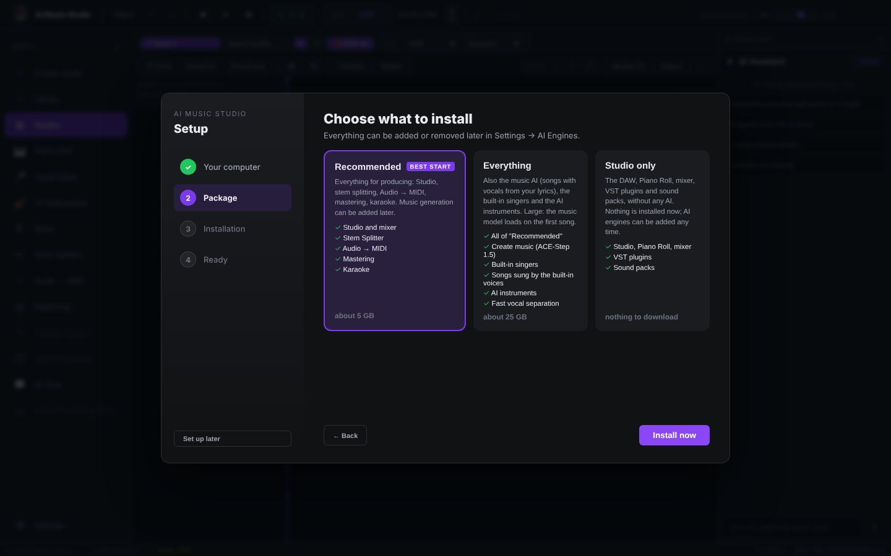

# Installation and Setup

## Install the app

1. Download `AIMusicStudio-Setup-<version>.exe` from the [latest release](https://github.com/pierrecinema/ai-music-studio/releases/latest).
2. Run it. Windows shows a blue window **"Windows protected your PC"** (SmartScreen) because the installer is not code-signed yet. It is not a virus warning: click **More info → Run anyway**.
3. Start AI Music Studio. The [[Studio]], [[Piano Roll]], [[Mixer]] and [[Library]] work right away.

Only one window runs at a time: starting the app again brings the open window to the front.

## Install the AI engines (once)

The AI features (songs, loops, stems, mastering, Audio → MIDI) run in a Python environment that the app sets up by itself.

**After every new installation the setup assistant opens on the first start** (not after updates; also later: **[[Settings]] → AI Engines → Setup assistant**). If the AI engines are already on the PC, it checks them and repairs what is missing:

1. **Your computer**: graphics card, processor, memory, free space and Python are checked.
2. **Package**: *Recommended* (Studio, stems, Audio → MIDI, mastering, karaoke; about 5 GB, 8 GB with an NVIDIA card), *Everything* (also the music AI, the built-in singers, the voice exchange, the AI instruments; about 28 GB) or *Studio only* (no AI, nothing to download). If the drive has too little free space, the assistant says so before anything is downloaded.
3. **Installation**: one click; the progress shows each step, the percentage and the time left; *Show details* opens the full log. Finished parts are kept if it is interrupted; *Try again* goes on from there.
4. **Ready**.

**No Python to install by hand**: if the PC has no Python 3.10 to 3.12, the app sets up its own Python 3.11 (the official installer from python.org, silently, only for this user, in the app's data folder; nothing else on the PC is changed). A Python 3.10 to 3.12 that is already installed is used.

The single packages can also be installed in **[[Settings]] → AI Engines**: tick them and click **Install selected**. At the end of every installation the app checks that PyTorch and torchaudio fit together and repairs them if not; the setup assistant also repairs a broken installation.

| Package (as named in the app) | What for |
|---|---|
| Core backend | the AI server, AI Chat, MIDI tools (always installed) |
| PyTorch | base of most local models (CPU, or CUDA for NVIDIA cards: the app picks the build that fits the card, CUDA 12.6 for GTX 9xx to RTX 40xx and 12.8 for RTX 50xx, and falls back to the processor build if none installs) |
| Stem separation (Demucs) | [[Stem Splitter]]: vocals, drums, bass, piano, guitar |
| Fast vocal separation (vocals + instrumental, 4 stems) | the fast Stem Splitter modes, on the graphics card (AMD, Intel, NVIDIA) |
| Audio → MIDI (basic-pitch) | notes from a stem into the [[Piano Roll]] |
| Mastering (Matchering) | [[Mastering]] |
| Lyric timing (faster-whisper) | word timing for the coming karaoke export |
| Video analysis | for the coming video composer |
| Music generator (ACE-Step) | full songs and LoRA (needs Git) |
| Light music generators (MusicGen, AudioLDM 2, MusicLDM) | instrumental clips and loops; run on old PCs (model weights: non-commercial use) |
| Graphics card support (AMD / Intel, DirectX 12) | MusicGen small on AMD and Intel graphics cards |
| ACE-Step 1.5: songs with vocals, also without a graphics card | songs with vocals from your lyrics, the turbo model also on the processor (experimental) |
| AI Instruments (MIDI-DDSP) | [[AI Instruments]]: 13 orchestral instruments play your MIDI tracks, on the processor (needs Python 3.10 or 3.11, about 1.5 GB) |
| DiffRhythm: full songs in one go | songs with vocals, NVIDIA only (experimental) |
| LoRA training (ACE-Step) | train your own style (NVIDIA), or build a bundle for another PC |
| Audio → MIDI (MuScriptor) | more accurate transcription (non-commercial only) |

Models are downloaded on first use (several GB, once). Where they are stored: [[Settings]] → Models.

## Uninstall

Windows → Settings → Apps → AI Music Studio → Uninstall. The uninstaller asks whether the **AI engines, the downloaded AI models and the settings** should go too (several GB). *Yes*: the next installation starts like the very first one, with the setup assistant. *No*: they stay, and a new installation uses them right away. Your songs and projects always stay. Updates never ask and never remove anything.

## Updates

The app checks for new versions at start and every few hours and installs them with one click (bottom right, or [[Settings]] → Updates). The app closes, installs and starts again by itself.

## Where things are stored

| What | Where |
|---|---|
| Settings, logs | `%APPDATA%\desktop` |
| AI environments | `%APPDATA%\desktop\engines` |
| Models | `%USERPROFILE%\.ai-music-studio\models` (changeable in Settings → Models) |
| LoRAs | `%USERPROFILE%\.ai-music-studio\loras` |
| Your songs and stems | `Music\AI Music Studio` |
