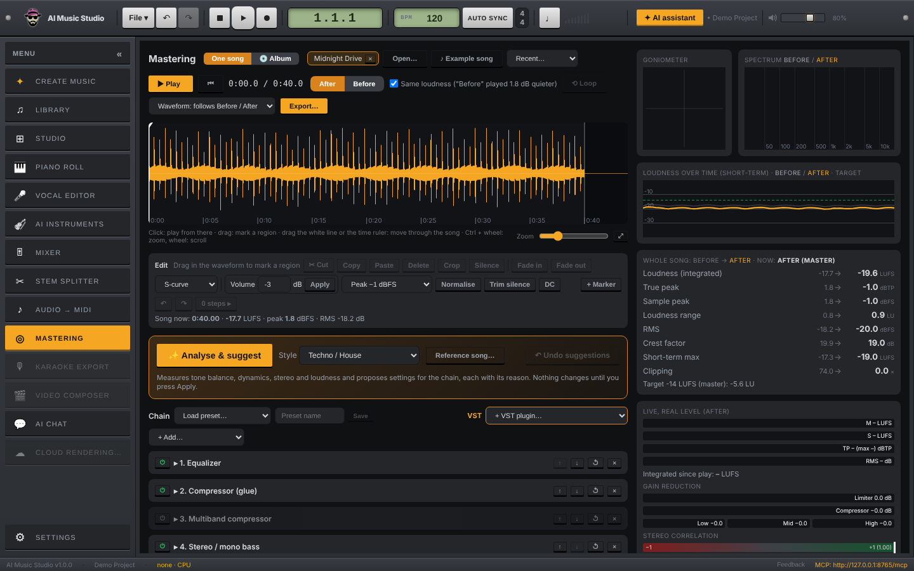
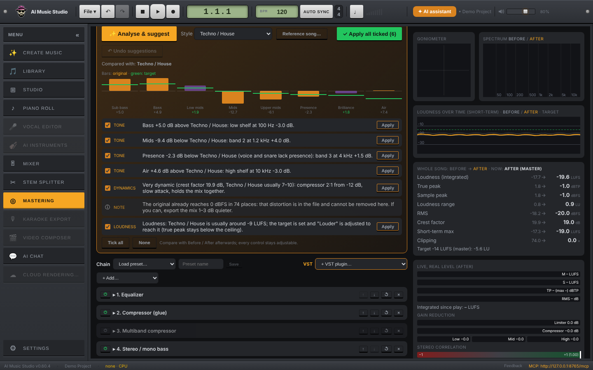

# Mastering ◎

A mastering workspace: drop a song in, hear it through a mastering chain, compare it with the original at the same
loudness, see every measurement before and after, and export it in any format. Everything runs in the app (no
plugin needed); what you hear while playing is exactly what is written to the file.

## Open a song
- **Drag** audio files (WAV, MP3, FLAC, OGG, M4A, AIFF) from the Explorer onto the page, or press **Open…**.
- **Library:** the **Mastering** button on a song. **Create music:** **Mastering** under a result.
  **Studio:** **File → Send song to Mastering** (renders the mix and opens it here).
- Open songs are tabs at the top (× closes one); **Recent…** lists the last 12.

## Listen and compare
- **▶ Play / ❚❚ Pause** (or **Space** on this page), **⏮** back to the start.
- **After / Before (A/B):** "Before" is the original, "After" the master. The whole page follows: the numbers, the
  waveform, the spectrum and the loudness curve of the side you hear are shown bright, the other side dim. In "Before"
  every control of the chain shows its starting value (read-only); in "After" each control you moved is marked
  purple with a dot.
- **Same loudness** (on by default): while comparing, the louder of the two is turned down, so you judge the sound,
  not the volume. Switch it off to hear how much louder the master really is. The meters always show the real level.
- **Waveform:** follows Before / After (or both, grey and purple), clipping in red. Click to play from there; **drag the white play line (its ▼ grip) or along the time ruler** to move through the song, also while it plays; **drag elsewhere to mark a region**,
  **⟲ Loop** plays it again and again. **Ctrl + wheel** or the slider zooms, also further out than the whole song; the view always reaches past the end of the song (darker), so the end is easy to see and to mark; **⤢** shows the whole song.

## Edit (cut and more)
Drag in the waveform to mark a region, then in the **Edit** bar:
- **✂ Cut** (Ctrl+X), **Copy** (Ctrl+C), **Paste** at the play position (Ctrl+V), **Delete** (Del), **Crop** (keep only the region), **Silence**.
- **Fade in / Fade out** over the region with an **S-curve**, **linear** or **logarithmic** shape.
- **Gain dB** and **Normalise** (peak −1 dBFS or −14 LUFS) for the region, or the whole song when nothing is marked; **Trim silence** at start and end; **DC** removes a DC offset.
- **↶ / ↷** (Ctrl+Z / Ctrl+Y) undo and redo; **n steps ▸** lists them. **+ Marker** at the play position (names can be edited, click the time to jump there).
- The original file is never changed: the steps are applied when you export. They are kept while the app runs.

## VST plugins in the chain
**VST + VST plugin…** (in front of **+ Add…**) lists your VST plugins (from [[Settings]] → Plugins). A plugin can sit anywhere in the chain (↑ ↓); **Open the plugin window** shows its own controls, ⏻ switches it on and off without changing the timing. Its settings are kept with the song and used in the export.

## Assistant

**✨ Analyse & suggest** measures the song: tone balance in eight bands (sub bass to air), dynamics (crest factor), stereo (bass width, correlation), clipping and silence. It compares the tone balance with a **Style** (Techno / House, Afro House, Trance / EDM, Pop, Hip-hop, Rock, Soul / R&B, Funk, Acoustic, Podcast) or with a **Reference song**, shows the bands (purple: song, green: target) and lists proposals with their reason (e.g. "Low mids +8 dB above Techno: band 1 at 300 Hz −4 dB"). Press **Apply** on a proposal to use just that one, or tick several and press **✓ Apply all ticked** (top right); the loudness target is reached afterwards, the page switches to *After* and a green box lists what was applied. The bars then show the **master** (purple), the original as a grey outline and the target in green. **Analyse the master again** starts a second round on the master; its EQ proposals add to what is set. **↶ Undo suggestions** brings the chain from before back. It works with measurements and rules, without internet, in a few seconds.

## Master gain fader
With the AI panel closed, the meters and the fader move to the right edge of the window (their own column): goniometer and spectrum, loudness over time, whole song, live, and the master fader at the bottom; with the AI panel open they sit beside the chain. **✦ AI assistant** in the top bar opens the AI panel again.

A big fader like on a mixing desk (right, above the meters) makes the master louder or quieter. It drives the song into the limiter, so it gets louder without clipping; next to it the live true peak, short-term loudness and how much the limiter holds back (orange). Drag, mouse wheel (Shift: fine), arrow keys, −1 / 0 / +1; double-click: 0 dB. It is the same value as *Louder* in the limiter.

## The chain
Slots are processed from top to bottom: **⏻** switches one off (bypass), **↑ ↓** moves it, **↺** resets it, **×** removes
it, **+ Add…** adds one (also a second EQ or compressor). Click a name to open its controls.

The controls are round knobs with a ring of lights: drag up or down to turn one (**Shift**: fine steps), or use the mouse wheel or the arrow keys; a **double-click** sets it back to its starting value. A purple name with a dot marks a knob that was moved.

| Slot | What it does |
|---|---|
| **Equalizer** | low cut, low shelf, three bands (frequency, gain, width), high shelf, high cut; the curve is drawn over the live spectrum |
| **Compressor (glue)** | threshold, ratio, attack, release, knee, make-up |
| **Multiband compressor** | three bands (two split frequencies), each with its own compressor and level |
| **Stereo / mono bass** | width (0 % mono … 200 %), bass below a frequency in mono, balance |
| **Dynamic EQ** | turns one frequency down only while it is too loud (sharp highs, booming bass): frequency, width, threshold, ratio, max. cut, attack, release; add it twice for two bands |
| **Saturation / exciter** | warmth (soft tape-like saturation: drive, mix) and air (new harmonics above a frequency), output level |
| **Limiter / maximizer** (always last) | **Louder** drives the song into it; **Ceiling** is the highest true peak allowed (4x oversampled, look-ahead), **Release** |

Each song keeps its own chain: opening it again brings its settings back.

**Target** (Streaming −14 LUFS, Apple −16, Loud −9, Broadcast −23, Podcast −16) and **Reach … LUFS** set *Louder* and
the ceiling so the song reaches that loudness. **Load preset…** offers built-in starting points; **Save** keeps your
own chain under a name.

## Meters
- **Whole song, before → after:** integrated loudness (LUFS, ITU-R BS.1770 / EBU R128), true peak, sample peak,
  loudness range, RMS, crest factor, short-term maximum, clipping; how far the song is from the target.
- **Live:** momentary and short-term loudness, true peak (with maximum), RMS, integrated since play, gain reduction of
  the limiter, the compressor and each multiband band, stereo correlation.
- **Goniometer**, **spectrum** (before grey, after purple) and **loudness over time** (before, after, target).

## Export…
- **Formats, several at once:** WAV, AIFF (16 / 24 / 32-bit float), FLAC, ALAC (16 / 24-bit), MP3 (128–320 kbps or
  VBR), AAC, OGG Vorbis, Opus.
- **Sample rate** 44.1 / 48 / 88.2 / 96 kHz (converted in high quality), **dither** (TPDF) when the bit depth is reduced.
- **Metadata:** title, artist, album, year, ISRC, comment and a **cover picture** (JPG / PNG), written into every format.
- **Preset for…** streaming, CD, Bandcamp, hi-res, YouTube, Apple, web. Choose a **folder** and a **file name**.
  Compressed formats use ffmpeg; if it is not on the computer, the app downloads it once.

## Album

Switch the page from *One song* to **💿 Album** to master an album or EP as a whole.

1. **Drag audio files** from the Explorer onto the album view, or **+ Add songs…** (or **+ All open songs**), and put them in order by dragging a song (⋮⋮) or with ▲ ▼; × takes a song off the album. A click on a name opens that song on its own page (its chain, editing, meters).
2. Choose the loudness target (Streaming −14 LUFS …). **Measure** shows every song's loudness before (grey) and after its chain (green: on target), with the target as a line.
3. **Even out the album**: every song gets the same loudness (its own chain's *Louder* is set, in two rounds because of the limiter). *Quiet songs may stay a little quieter* keeps part of the difference, like a ballad on a real album (never louder than the target + 1 LU). *Even out lows and highs too* moves each song's EQ low and high shelf half way to the album's average (at most 3 dB).
4. **Pause** (chosen at any transition, 0 to 8 s, the same for the whole album) and **▶ Hear the transition**: the last 8 seconds of a song, the pause and the first 8 seconds of the next. The **album player** shows the album as one timeline: click anywhere to play from there, ⏮ ⏭ jump between songs, the yellow ⇄ marks play a transition; a click on a song's number plays from that song.
5. **Export the album…**: choose a folder; every song is written as "01 - Title" in the formats of the song export, with album, artist and track number in the tags. *Also the whole album as one file* adds one file of all songs with their pauses.

## Reference match
**Reference match (sound like another song)** matches loudness, tone balance and stereo width to a song you like
(Matchering, needs *Mastering* in [[Settings]] → AI Engines). The result opens as a new tab and can go through the chain.
