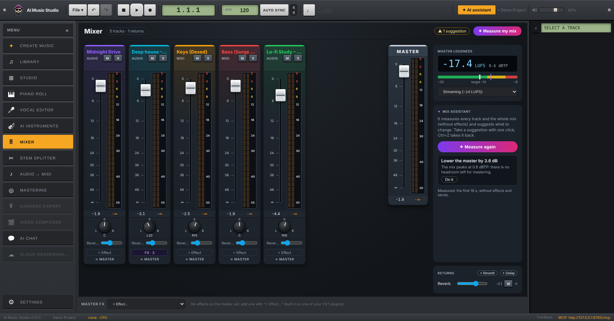

# Mixer 🎚

A full page since 0.99.13: a **card for every track**, the **master**, and on the right the **loudness**, the **mix assistant** and the **returns**. With many tracks the cards scroll sideways (scroll bar at the bottom, or the mouse wheel over the cards); the master stays next to them. Changes are heard at once while playing.

## A track card
From top to bottom: the **name** in the track colour and its type (Audio / MIDI), **M** (mute) and **S** (solo), a **⚠ hint** when the mix assistant has a suggestion for this track (hover for the details), the **fader** with a dB scale and the **LED level meter**, the fader value and the last peak in dB, the **pan** knob, one **send** slider per return (reverb / delay), a **FX** chip (how many effects; a click opens them in the [[Studio]]) and where the sound goes (*→ Master* or the group). Everything has a tooltip.

## Master loudness and the mix assistant
**Master loudness** shows the loudness of the whole mix in LUFS and its true peak, with a marker for your **target** (streaming −14, podcast −16, loud −9, broadcast −23). The **mix assistant** (*✦ Measure my mix*) plays every track offline for the first minute of the song, without effects and sends, measures each one and the whole mix, and suggests, each with the reason:
- **lift the vocals** when they are quieter than the loudest instrument;
- **balance bass and drums** when one is much louder;
- **lift a track** that is more than 14 dB below the loudest;
- **spread instruments** that all sit in the middle to the left and right;
- **take 3 dB of low end out of the drums** (an EQ insert) when drums and bass both carry much energy below 140 Hz;
- **lower the master** when the mix peaks above −1 dBTP.

**Do it** takes one suggestion, **✦ Balance the whole mix** all of them; Ctrl+Z takes it back. Faders end at 0 dB: when a lift would go past it, everything is moved down by the same amount so that the balance stays. This is a measuring assistant with fixed rules (not a neural network): it hears levels, panning and the low end, not taste.

## The controls
| Control | What it does |
|---|---|
| **Fader** | volume with a dB scale (0 at the top, then 6, 12 … 48, ∞): drag the white cap, mouse wheel, **Shift** for fine moves, double-click for 0 dB |
| **Pan** | the black knob: drag sideways or up / down, or the mouse wheel; double-click: center (L, C, R around it) |
| **M / S** | mute / solo (the key lights orange / green) |
| **Level meter** | two orange LED columns with a scale in dB below full level (red 0–3, yellow 6–9); the held peak shows as one lit segment |
| **Sends** | how much of the track goes to a reverb or delay return (after the fader) |
| **Returns** (right) | level and mute of each return, **+ Reverb / + Delay** to add one, × to remove it |
| **Group tracks** | tracks routed through a group track with its own volume, mute and solo (Ctrl+G) |

**Master FX** (bottom of the Mixer, and *Master FX* in the Studio toolbar): effects on the whole mix, after all tracks and return tracks: built-in effects or your VST plugins (*Open* shows the plugin window). They are saved with the project and are in the export.

The master has a limiter so the mix does not clip hard. Shortcut: Ctrl+Alt+M (Ableton) / F3 (Cubase).
