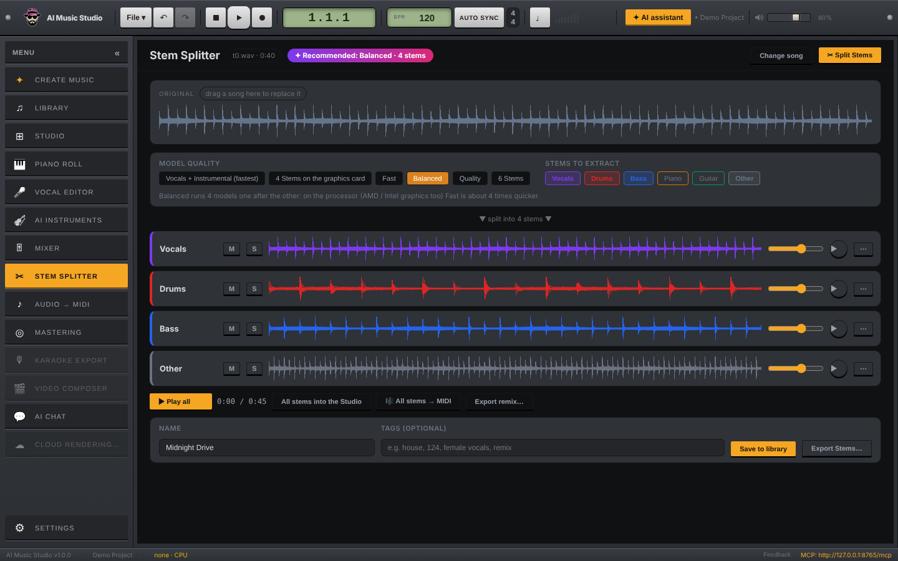

# Stem Splitter ✂

Split a song into its parts (stems): vocals, drums, bass, piano, guitar, other.

Drop a file on the page or choose one, or send a song here with the **Stem Splitter** button in [[Create Music]] (results) or the [[Library]].

## Modes
| Mode | Stems | Runs on | Needs |
|---|---|---|---|
| **Vocals + Instrumental (fastest)** | vocals, instrumental | graphics card (AMD, Intel, NVIDIA), else processor | *Fast vocal separation* |
| **4 Stems on the graphics card** | vocals, drums, bass, other | graphics card, else processor | *Fast vocal separation* |
| **Fast** | 4 stems | processor / NVIDIA | *Stem separation (Demucs)* |
| **Balanced** | 4 stems, cleaner (4 models in a row) | processor / NVIDIA | Demucs |
| **Quality** | 4 stems | processor / NVIDIA | Demucs |
| **6 Stems** | adds piano and guitar | processor / NVIDIA | Demucs |

Install the packages in [[Settings]] → AI Engines. A progress bar shows the percent and the device ("Done (DirectML)" = graphics card). **✕ Cancel** stops; one split runs at a time.

## The page
The song is drawn as a waveform at the top (drag another song onto the page or press **Change song** to replace it). Under it: the model and the stems to extract; the top bar shows the recommended setting and the **✂ Split** button (during the split **✕ Cancel**, with progress and time left).

## Stem lanes
After splitting, every stem has its own coloured lane under the song: name, **M** (mute), **S** (solo), its waveform, volume, **▶** (hear only this stem; press again to stop) and **⋯** (→ MIDI, → Studio, Mastering, save as file). **▶ Play all** plays them together; a white line runs through all lanes, click or drag in any waveform to jump.
- **Export remix…:** mixes the stems you hear at these levels, e.g. mute Vocals for a karaoke version ("… – no vocals").
- **→ MIDI** (in the **⋯** menu): turns a stem (bass, vocals, piano…) into notes on a new MIDI track, opened in the [[Piano Roll]].
- **All stems → MIDI:** all stems at once on the [[Audio to MIDI]] page, with the drums, tempo, key and chords.

## Saving
- **Mastering** (in the **⋯** menu) opens it in [[Mastering]] (e.g. the instrumental).
- **Save to library** with a name and tags: the stems go to the [[Library]] → *Stems*. **Open Library → Stems** jumps there.
- **Export Stems…:** every stem as its own file (WAV, AIFF, FLAC, MP3) for any DAW.

In the [[Studio]], right-click a song clip → **Split into stems (Demucs)** splits it right there; the stems arrive as new tracks.

## Into the Studio
**All stems into the Studio** puts every stem on its own audio track in the [[Studio]], in one group named after the song, from bar 1, with the levels and mutes of the stem mixer. **→ Studio** in a lane's **⋯** menu puts only that stem on a new track.
